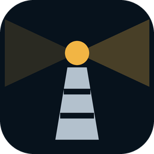

<p align="center">
  
</p>

<h1 align="center">Fyrlys</h1>

<p align="center">IPTV-spiller for Windows, Android-telefoner og Samsung-TV-er: TV, TV-guide, TV-arkiv, filmer og serier.</p>

<p align="center">
  <a href="https://github.com/ungerdas/fyrlys/releases/latest/download/Fyrlys-oppsett.exe"><b>Last ned for Windows</b></a>
  &nbsp;·&nbsp;
  <a href="https://github.com/ungerdas/fyrlys/releases/latest/download/Fyrlys-android.apk"><b>Android</b></a>
  &nbsp;·&nbsp;
  <a href="#samsung-tv"><b>Samsung-TV</b></a>
  &nbsp;·&nbsp;
  <a href="CHANGELOG.md">Hva er nytt</a>
  &nbsp;·&nbsp;
  <a href="README.en.md">English</a>
</p>

<p align="center">
  <a href="https://github.com/ungerdas/fyrlys/releases/latest"></a>
</p>

Fyrlys spiller abonnementet ditt hos en IPTV-leverandør, med M3U-lenke eller Xtream Codes. Den har ingen kanaler selv.
Appen er på norsk eller engelsk (som Windows, telefonen eller TV-en; byttes under tannhjulet → Utseende).

## Funksjoner

- TV med favoritter, kategorier, søk og kanalnummer
- TV-guide, og TV-arkiv når leverandøren har det
- Pause og spol tilbake i direktesendinger
- NRK1, NRK2, NRK3 og NRK Super fra NRK sine egne direktesendinger, én kanal hver (leverandørens strøm er reserven)
- Filmer og serier med «Fortsett å se» (Xtream Codes)
- Plex: filmene og seriene på Plex-serveren din i en egen fane, med «Fortsett å se», sett/ikke sett, hopp over intro og neste episode (tannhjulet → Plex). Med Plex Home velger du hvem som ser på
- Flere innlogginger, hver med sine egne favoritter, og multiview med en kanal fra hvert abonnement
- mpv som avspiller: de fleste formater, lydspor og undertekster
- Minispiller som ligger øverst (Windows), bildeformat og lydforsinkelse per kanal
- Cast til TV med Chromecast (PC-en eller telefonen sender strømmen videre, så Fyrlys må være på mens du caster)
- Oppdaterer seg selv

## Kom i gang

1. Last ned og kjør [`Fyrlys-oppsett.exe`](https://github.com/ungerdas/fyrlys/releases/latest/download/Fyrlys-oppsett.exe)
   (Windows 10 og 11). Advarer Windows, velg *Mer informasjon → Kjør likevel*.
2. Logg inn med M3U-lenken eller Xtream-innloggingen fra leverandøren. Den lagres kryptert, bare på PC-en.
3. Innstillingene ligger under tannhjulet øverst.

Noe som ikke virker? Åpne feilrapporten (tannhjulet → Hjelp → Feilrapport), kopier den og [meld fra](https://github.com/ungerdas/fyrlys/issues/new/choose).

Vil du ikke installere, kan du bruke [`Fyrlys-windows.zip`](https://github.com/ungerdas/fyrlys/releases/latest/download/Fyrlys-windows.zip) i stedet.

### Android

1. Last ned [`Fyrlys-android.apk`](https://github.com/ungerdas/fyrlys/releases/latest/download/Fyrlys-android.apk) på
   telefonen og åpne den. Første gang spør Android om nettleseren (eller filbehandleren) får installere apper: tillat det.
   Appen ligger ikke i Google Play.
2. Logg inn som på PC-en. Innloggingen lagres bare i appen på telefonen.
3. Nye versjoner: appen sier fra, laster ned når du trykker *Last ned* og installerer med *Installer* (første gang må du
   tillate at Fyrlys installerer apper).

Android 7 eller nyere, på telefoner (ARM) og i emulatorer som BlueStacks (velg en 64-bit-instans der). Snu telefonen for å se på hele skjermen. Når du caster, sender
telefonen strømmen videre til TV-en: et varsel viser at Fyrlys er i gang, også med skjermen av. Lukker du appen, stopper
castingen.

### Samsung-TV

Samsung-TV-er fra 2021 og nyere (Tizen 6.0 til 10.0). Fyrlys ligger ikke i Samsungs appbutikk, så den installeres fra
en PC eller telefon, med TV-en i utviklermodus:

1. Last ned pakken for året TV-en er fra (står bak på TV-en, eller under *Innstillinger → Kundestøtte → Om denne TV-en*):
   [2021](https://github.com/ungerdas/fyrlys/releases/latest/download/Fyrlys-tizen-2021.tpk),
   [2022–2025](https://github.com/ungerdas/fyrlys/releases/latest/download/Fyrlys-tizen-2022-2025.tpk) eller
   [2026](https://github.com/ungerdas/fyrlys/releases/latest/download/Fyrlys-tizen-2026.tpk).
   TV-ens avspiller er bygget for én Tizen-versjon av gangen, så pakken må passe; tar du feil, sier Fyrlys hvilken som
   passer når du starter en kanal.
2. Slå på utviklermodus: åpne *Apps* på TV-en, tast 1 2 3 4 5 på fjernkontrollen (eller på talltastaturet på skjermen),
   slå på *Developer mode* og skriv inn IP-adressen til PC-en eller telefonen du installerer fra. Start TV-en på nytt
   (hold av/på-knappen inne til den slår seg av og på igjen).
3. Installer pakken med [Apps2Samsung](https://github.com/Apps2Samsung/Apps2Samsung) (gratis, for Windows, Mac, Linux,
   Android og iPhone; ikke en del av Fyrlys): velg TV-en, velg *din egen `.tpk`* og trykk *Install*. Første gang logger
   du inn med en Samsung-konto, så lager den et sertifikat som gjelder TV-en din (TV-er godtar bare apper signert for seg).
4. Fyrlys ligger under *Apps*. Logg inn som på PC-en.

Nye versjoner: Fyrlys sier fra på TV-en, og du installerer den nye pakken på samme måte (fra samme PC eller telefon, så
blir innloggingen og favorittene liggende).

På TV-en spiller TV-ens egen avspiller, så det er TV-en som bestemmer hvilke formater som virker. Pause og spoling i
direktesendinger, multiview, minispiller, lydforsinkelse og Chromecast finnes ikke der. Fjernkontrollen: ↑/↓ bytter
kanal, OK gir kanallista, Tilbake går tilbake, grønn eller Info går til knappene under bildet (lydspor, undertekster,
bildeformat), rød er TV-arkivet, blå *Se fra start* og gul bildeformat.

<details>
<summary>Taster</summary>

| | |
| --- | --- |
| ↑ / ↓ | forrige og neste kanal |
| 0–9 | kanalnummer |
| ← / → | 10 sekunder tilbake og fram |
| Mellomrom | pause |
| F | fullskjerm |
| I | minispiller |
| Z | bildeformat |
| C | kanallista |
| A | TV-arkivet |
| V | multiview |
| S | hopp over introen eller rulleteksten (Plex) |
| Esc | tilbake |

</details>

## Bygge selv

Laget i Flutter, med [media_kit](https://github.com/media-kit/media-kit) og [mpv](https://mpv.io). Byggene lages av
[GitHub Actions](.github/workflows/build.yml).

```bash
flutter create --org no.fyrlys --project-name fyrlys --platforms=windows,android .
flutter run
```

Avspilleren er [mpv](https://mpv.io) (libmpv, LGPL), fra [mpv-winbuild](https://github.com/zhongfly/mpv-winbuild).
